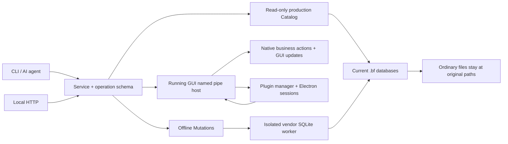

# Billfish CLI and local API

这套接口让 AI 和脚本查询当前 Billfish 素材库, 读原文件和当前真实 GUI 选区, 在 GUI 开着时维护备注/来源/标签, 或把选定素材复制到另一个普通文件夹. 在线写入复用软件的原生业务动作, 更新软件内的数据与界面. 本地 JavaScript / HTML 模块可以作为插件安装, 在设置中即时开关和运行; 当前 Electron runtime 接入 Eagle window/service manifest 的已实现子集. 素材仍保留在原来的磁盘目录, 文件名和内容不因标注而改变. GUI 继续通过根目录 `Billfish.exe` 启动.

CLI/API 支持 Windows x64, 当前完整维护包内置官方 Python 3.14.8 x64 embeddable, `billfish-cli.cmd` 优先使用 `tools/python/python.exe`, 无需另装 Python 或 pip 包. 缺少 bundle 的开发环境仍可使用 Python 3.11+ x64. 查询使用 Python 标准库. 插件使用独立 Electron 进程, 默认运行目录为 `tools/electron`, 与 Python CLI 分开. DLL 首次升级后重启一次 Billfish, 日常写入和插件开关即时生效. 离线写入需要匹配冻结版本的 native DLL. Git 源码目录本身不包含完整运行时, 迁移步骤见 [portable-migration.md](../docs/portable-migration.md).

## 立即使用

在 Billfish 根目录打开 PowerShell:

```powershell
.\billfish-cli.cmd --version
.\billfish-cli.cmd schema
.\billfish-cli.cmd info
.\billfish-cli.cmd search '石头' --limit 20 --ext png --ext jpg
.\billfish-cli.cmd item 123
.\billfish-cli.cmd selected
.\billfish-cli.cmd folders
.\billfish-cli.cmd tags
```

默认库选择顺序: `--library` > `BILLFISH_LIBRARY_ROOT` > 在线宿主实际打开的库 > 当前用户 `recent_lib.ini` 的 `LastLoadLibPath`. 不扫描磁盘寻找其他库. 可以显式指定:

```powershell
.\billfish-cli.cmd --library 'D:\Assets\ReferenceLibrary' info
```

`--library` 放在子命令前. 查询可以在 GUI 运行时执行. 完整包的 `billfish-cli.cmd` 不依赖 PATH 中的 Python; 直接调用时可用 `tools\python\python.exe -I automation\billfish_cli.py`. CLI 正常结果写入 stdout 的一个 UTF-8 JSON 对象, diagnostics 写 stderr. 成功 exit 0, 参数错误 exit 2, 业务失败 exit 1, 一次性命令被取消 exit 130. 取消后需要读回核对状态, 不把取消响应当作成功或保证已回滚.

```json
{"ok":true,"data":{"...":"operation result"}}
```

```json
{"ok":false,"error":{"code":"library_mismatch","message":"...","details":{}}}
```

## 已实现的业务命令

所有命令的完整参数定义可由 `schema` 获取, 同一个定义用于 CLI 参数校验和 OpenAPI. ID 统一为十进制字符串, 避免 JavaScript 处理 64-bit ID 时丢失精度.

| Operation | 用途 | 写入条件 |
| --- | --- | --- |
| `library.info` | 当前库, schema, 数量, 搜索语义 | 只读 |
| `items.search` | 名字/备注/来源/标签的字面文本搜索, 目录/标签/扩展名过滤, 分页 | 只读 |
| `items.get` | 真实路径, 文件大小, 元数据, 标签, 尺寸, 时长, 现存预览路径 | 只读 |
| `items.selected` | 当前 GUI 视图真实选中的素材, 含完整素材数据 | 只读; 需要 GUI 打开库; 参数只能是 `{}` |
| `items.import_path` | Copy 导入绝对路径的本地文件, 返回真实素材 ID | 需要 GUI; 直接执行, 无 dry-run |
| `items.import_url` | 下载 HTTP(S) 图片并通过原生业务导入 | 需要 GUI; 直接执行, 无 dry-run |
| `video.capture` | 接受视频采集, 弹出实际分辨率选择后下载入库 | 需要 GUI; 立即返回 accepted/job_id, 完成需查询 jobs |
| `folders.list` | 目录层级和磁盘路径 | 只读 |
| `tags.list` | 活跃 `bf_tag_v2` 标签 | 只读 |
| `items.export` | 复制选中素材, 保留相对目录, 不覆盖已有目标文件 | 默认 dry-run; 不改库 |
| `items.update` | 批量修改 `note` / `origin`, 同步原生全文索引 | 默认 dry-run; GUI 开着时调用原生业务层 |
| `tags.create` | 建立原生标签, 可指定父标签 | 默认 dry-run; GUI 开着时调用原生业务层 |
| `tags.assign` | 批量添加/移除素材标签 | 默认 dry-run; GUI 开着时调用原生业务层 |
| `host.info` | 检查在线宿主, 实际库路径, 原生桥接状态 | 需要 GUI |
| `jobs.list` / `jobs.get` | 查询近期在线任务与真实完成状态 | 需要 GUI; 记录保留在当前进程内 |
| `plugins.list` | 查询已安装插件, 开关, 运行状态和命令 schema | 需要 GUI |
| `plugins.install` | 从本地 `.eagleplugin` / `.zip` 或开发目录异步安装/更新 | 需要 GUI; `source_path`; 新插件默认关闭, 更新等待显式激活 |
| `plugins.enable` | 持久化插件开关, 启动或停止插件进程 | 需要 GUI; 即时生效 |
| `plugins.run` | 运行已启用插件的声明命令 | 需要 GUI; 根据插件命令产生副作用 |
| `ui.settings.open` | 打开 Billfish 设置中的插件页 | 需要 GUI |

`items.search` 的 `folder_id` 只匹配直接子素材, 不递归. `limit` 为 1..500, 默认 100; `offset` 默认 0. 顺序固定按 ID 升序. 搜索是主库上的字面 `LIKE`, `%` 和 `_` 作为普通字符处理, 不等价于 GUI 的原生全文搜索. 默认排除回收素材及回收目录后代. `include_recycled=true` 允许读其记录, 但不返回未经确认的回收物理路径. 链接素材同样不猜测目标路径. `exists=false` 与 `path_error` 分别表示文件缺失和路径无法可靠解析.

`items.get` 常用结果字段: `id`, `folder_id`, `name`, `path`, `relative_path`, `exists`, `path_error`, `file_size`, `width`, `height`, `duration_ms`, `note`, `origin`, `score`, `tags`, `thumbnail_path`, `preview_path`. 缺少预览时相应路径为 `null`, 不保证每种素材都有预览.

当前契约共 21 个 operation. `selected` 是 `call items.selected` 的快捷入口, 参数严格为 `{}`, 不接受调用者提供 `item_ids`. 它从当前原生视图的 Qt selection model 获取选中素材, 再在同一次只读 snapshot 中补齐元数据, 返回 `{items,total,item_ids,source,library_root}`. 只有真实空选区才返回 `items:[]`; 库未打开或选区上下文无法验证时返回错误, 不伪装为空成功. 详情页预览, 历史选择和搜索结果列表不作为当前选区来源. 显式目标库必须与当前 GUI 库一致, 读取前后都会核对库身份.

公有 `items.selected` 完整响应上限为 16 MiB, 插件 SDK 的完整 host_result envelope 上限为 4 MiB. 超限返回 `selection_too_large`, 不截断选区. 插件可捕获错误后提示减少选中数量, session 仍可继续使用.

## 一条可复现的 AI 标注流程

先查询并记录需要标注的 ID. 外部 AI 可用 `path` 读取原文件, 或用 `thumbnail_path` 读取现有预览. 下面用示例 ID `123` 和 `456`, 实际执行前替换为查询结果.

将参数保存为 `update.json`:

```json
{
  "updates": [
    {"item_id":"123","note":"灰色岩石, 粗糙表面, 适合作为环境材质参考"},
    {"item_id":"456","origin":"https://example.com/reference"}
  ],
  "dry_run": true
}
```

```powershell
.\billfish-cli.cmd call items.update --input .\update.json
```

返回计划中的 `before` 和 `changes` 可用于检查. `dry_run` 不写数据库. 将 `dry_run` 改为 `false`, 再执行同一条命令即可应用. GUI 开着时, 请求自动转发到当前用户的本机 named pipe, 由宿主调用原生业务动作并同步界面; 不需要关闭软件或重启 HTTP 服务. 实际在线修改成功后包含 `source:"online"`, `job_id`, `completion:"persisted_metadata_verified"` 和原生结果; 宿主在原生完成通知之后独立读回主库, 核对请求的 metadata 已落盘. GUI 关闭时自动使用离线维护路径, 此时成功结果包含 `offline:true` 和备份位置. 两条路径的批次一致性不同, 见下文.

创建和分配标签也通过相同入口. 以下分别保存为 JSON 参数文件, 先 dry-run, 执行时指定 `dry_run:false`:

```json
{"name":"环境参考","pid":"0","dry_run":true}
```

```powershell
.\billfish-cli.cmd call tags.create --input .\create-tag.json
```

从成功创建结果的 `tag.id` 取 ID, 然后使用:

```json
{"item_ids":["123","456"],"tag_ids":["7"],"mode":"add","dry_run":true}
```

```powershell
.\billfish-cli.cmd call tags.assign --input .\assign-tags.json
```

`mode:"remove"` 移除关联而不删除素材或标签. 一次最多 500 个素材/标签配对. 重复添加/移除已处于目标状态的关联是 no-op. 标签使用 Billfish 的原生标签体系. 新标签由原生业务动作创建; 离线维护时 `seq` 采用同父级最大值加一, `icon/color/born` 为 0, `born=0` 表示未设置创建时间.

`items.export` 接受 `item_ids`, `destination`, `dry_run`, 目标必须在源库外. 它保留相对目录, 只复制, 不覆盖. 复制多个文件不是数据库事务; I/O 失败时 `error.details.completed` 列出已完成的副本, 并清理本次未完成的副本. 若清理也失败, `partial_destination` 和 `cleanup_error` 标明残留位置. 原素材保持原位.

## 新增导入与浏览器视频采集

本节描述已部署的导入/采集契约. URL 图片真实导入和 Pinterest 原包 UI 保存已通过, 包括完整标题文件名核对. 当前实际 Edge/Bilibili 4.2.0 按钮经用户点击并选择/确认分辨率后, 唯一新任务已完成下载和原生入库, 文件经 FFprobe 核验并在 Billfish 实际播放. 这是浏览器 E2E, 不只是 direct nativecmd. 早前 host-not-found 确有复现, 完整重启 Edge 后恢复, 失败分支未被日志捕获, 不宣称已确定根因或永久解决.

`items.import_path` 复制单个可读本地文件到当前 GUI 打开的库, 原 source 保留. 参数例如存为 `import-path.json`:

```json
{"source_path":"C:\\Assets\\reference.png","name":"reference.png","origin":"https://example.com/reference","folder_id":"0"}
```

```powershell
.\billfish-cli.cmd call items.import_path --input .\import-path.json
```

`source_path` 必须为绝对文件路径. `folder_id` 是 0..2147483647 的十进制字符串, 默认 `"0"` 为库根; 非根目标必须是库内有效且存在的目录. 可省略 name/origin, name 不含路径且须符合实际文件扩展名, 不通过改扩展名转换格式. 这不是移动, 替换原素材或递归导入接口.

`items.import_url` 下载 HTTP(S) 图片, 按内容识别图片格式并验证解码, 再走同一原生 Copy 导入. 目前支持 PNG/JPEG/GIF/WebP/BMP/TIFF 图片, 图片下载上限 100 MiB, HTML/错误页不能当图片导入. 参数例如:

```json
{"url":"https://example.com/reference.jpg","name":"reference.jpg","origin":"https://example.com/source","folder_id":"0"}
```

```powershell
.\billfish-cli.cmd call items.import_url --input .\import-url.json
```

导入没有 `dry_run`, 不提供离线写库回退. name/origin/folder_id 可省略, origin 可为 HTTP(S) 或空字符串. 网络 URL 不接受内嵌账号密码. 成功等待原生真实 ID 和主库/文件核对, 返回 `completion:"native_import_persisted"`, `item_id`, `item_ids`, `item`, `analysis_ready`. `analysis_ready:false` 表示缩略图或分析尚未齐备, 不把已落盘素材误称为全部分析完成. 返回 ID 来自原生结果, 不根据文件名或搜索差集猜测, 也不保证重复输入一定创建全新 ID.

导入超时, 取消或切库不保证回滚. 错误可能携带已观察的 item IDs, submitted/outcome 与 `rollback:false`; 先查询 jobs 和实际素材, 不自动重发. 宿主持有下载临时 source 到原生 importer 确认释放, 不把请求中断当作可以删除源文件的信号.

`video.capture` 接受页面或实际媒体 URL, 参数例如:

```json
{"url":"https://example.com/watch/123","page_url":"https://example.com/watch/123","title":"Reference video","media_url":"https://example.com/media/video.mp4"}
```

```powershell
.\billfish-cli.cmd call video.capture --input .\capture-video.json
```

只有 url 必填, page_url/media_url 为可选 HTTP(S), title 可选. YouTube/Bilibili 使用视频页作为 url, 通用页面可携带明确发现的 media_url. 响应 `accepted:true` 和 job_id 只证明受理. Billfish 先探测实际可用格式, 用户在软件内明确选择分辨率后才下载, 不自动降级为另一格式. `jobs.get` 跟踪真实终态. 下载通过 FFprobe 核对选定画幅/帧率/所需音轨, 缺失 HLS/DASH 分片会失败, 不把残缺媒体导入为成功.

视频目标取当前绑定库真实浏览器采集配置和 native folder, 不将任意当前选中目录或手工伪 ID 作为目标. 缺失默认目录的准备/绑定经原生业务处理. 不支持 playlist, live 或 DRM/账号限制绕过, 不读取浏览器 cookies/凭据. 维护版浏览器扩展通过原采集框拖拽或右键提交, Native Messaging 只发送一次请求; 提交结果不确定时保留 job_id, 先核对再决定后续操作. 部署/扩展加载步骤见 [浏览器维护版说明](../browser-extension/maintained/README.md), [Native Messaging host](../browser-extension/native-host/README.md), 下载边界见 [MEDIA_TRANSFER.md](MEDIA_TRANSFER.md).

## 在线状态, 进度和插件

无参数操作可直接调用:

```powershell
.\billfish-cli.cmd call host.info
.\billfish-cli.cmd call jobs.list
.\billfish-cli.cmd call plugins.list
.\billfish-cli.cmd call ui.settings.open
```

`host.info` 的 `ready:true` 表示当前已取得原生库 owner, `library_root` 是实际打开的库. 显式指定的库必须与该 owner 一致, 不一致时返回 `library_mismatch`; 宿主未就绪时拒绝写入. GUI 已运行但桥接不可用时也拒绝写入, 不会改用在线 SQL 写库.

软件主窗口右下角显示非模态进度条. 它不获取键盘焦点, 鼠标可穿透, 可以继续浏览素材. 原生动作按实际完成步骤更新进度; 尚无可计数总量时显示忙碌状态. 全部任务结束后自动隐藏. 进度条是状态提示, 不提供取消按钮.

调用超时或连接中断并不等于任务取消. 保留错误中的 `job_id`, 将以下内容存为 `job.json`, 查询同一任务后读回素材, 不要立即重发写入:

```json
{"job_id":"替换为返回的-job_id"}
```

```powershell
.\billfish-cli.cmd call jobs.get --input .\job.json
```

任务状态为 `accepted`, `running`, `completed` 或 `failed`. 最多保留当前进程最近 200 个已结束任务, 重启后不保留历史. `failed` 时检查 `error` 和可用的 `result`, 部分修改可能已完成.

插件可从软件设置的插件页选择包文件或开发目录安装, 开关和运行, `.eagleplugin` 还可拖入主窗口. 也可将以下各行分别保存为 JSON 文件, 按顺序调用. 示例安装路径请替换为当前安装目录或下载包路径; 素材 ID 使用自己查询到的值:

```json
{"source_path":"E:\\Billfish\\automation\\examples\\plugins\\example.material-notes"}
```

```powershell
.\billfish-cli.cmd call plugins.install --input .\install-plugin.json
```

```json
{"id":"example.material-notes","enabled":true}
```

```powershell
.\billfish-cli.cmd call plugins.enable --input .\enable-plugin.json
.\billfish-cli.cmd call plugins.list
```

`source_path` 也接受本地 `.eagleplugin` / `.zip`, 不再接受旧 `source_directory`. 安装不执行插件入口, 请求等待最终结果, 期间可查 jobs 进度. 新插件默认关闭; 同 ID 更新需停用原 session, 完整替换后状态为 updated, 等待显式激活. 开启后等待 `plugins.list` 中 `status:"ready"`, 再运行:

```json
{"plugin_id":"example.material-notes","command":"annotate","arguments":{"item_ids":["123"],"note_prefix":"环境参考: "}}
```

```powershell
.\billfish-cli.cmd call plugins.run --input .\run-plugin.json
```

该示例已迁移为 HTML/JavaScript, 会覆盖指定素材备注, 并通过宿主回报进度. `plugins.run` 遵循显式 `--library` 或 `BILLFISH_LIBRARY_ROOT`; 设置页的运行按钮使用 GUI 当前原生库. 插件 session 固定绑定启动时的库, 切库会废弃整个旧 session, 对已启用插件新建会话. 旧页面与 Item 对象不能漂移到新库继续写入. 初始无打开库时, 不访问素材库的纯工具仍可运行, 但其库 SDK 调用返回 `library_not_open`.

关闭时将 enable 文件的 `enabled` 改为 `false`. 开关意愿独立持久化, 下一次启动恢复已启用插件. 插件在独立 Electron 进程中执行, SDK 暴露受支持的 `eagle` API 和自有 `billfish` 命令/进度扩展. manifest 权限约束宿主 SDK 的可调用 operation, 不构成 OS sandbox. 旧 Python 插件目录保留为 incompatible, 不再使用旧 runner. 编写 manifest, 支持范围, 生命周期, 输入 schema, SDK 及停用语义见 [PLUGINS.md](PLUGINS.md).

Electron 与 Qt 宿主通过每 session 随机创建, 仅当前用户可访问的私有 named pipe 交换 JSONL. stdout/stderr 仅排空, 不作为宿主 API 通道, 不提供 stdio fallback. 该进程间通道与 CLI 的 stdout JSON 输出是不同边界.

不带自有命令扩展的 Eagle window/service 插件通过生成的 `run` / `open` 命令打开. `opened:true` 和 `plugin_window_opened` / `plugin_service_started` 表示窗口或服务已打开, 不代表页面内业务任务完成. 需要等待结构化结果的自有功能应声明 `billfish.commands` 并注册 handler.

普通 window 的 `ready` 仅表示 runtime 已能接收打开请求, 首次 run 才建页并触发 `onPluginCreate`; service/commands 在 ready 之前完成 create. 插件 SDK 的主题来自 OS nativeTheme, 尚未接入 Billfish 自定义主题变化. 含非空 preview 的包仍不在支持范围内. 资源 dependency 安装后可供消费者解析, 不独立运行; 当前 extraModule 仅实现 FFmpeg. 完整安装限额, 更新/依赖激活和 Edge 下载打开边界见 [plugin-installation.md](../docs/plugin-installation.md).

当前机器已按授权将 `.eagleplugin` 默认打开方式注册到根 `Billfish.exe`, 并用 Windows effective association 查询确认. 本地包冷启动和 GUI 已运行时打开均已实测成功, 安装后定位设置页且新插件关闭. Pinterest 1.1.9 原包已显示实际相似图结果, 并通过未修改的原 UI 保存到真实库, 完整 name/文件/ID 已核对. video2gif 1.0.2 原包已生成经 ffprobe 核验的普通 GIF 文件. GIF 一键替换仍未实现, 不称为原包全功能兼容. 上轮 Edge 包下载直链在工具中遭拦截, 没有完整浏览器包下载再安装的验收结果, 该限制与本轮视频 Native Messaging 问题是不同流程.

## HTTP API

HTTP 是显式启动的本机服务, 不加入开机启动, 不依赖 GUI 监听. 固定绑定 `127.0.0.1`, 默认端口 `27393`. 所有端点都要求 bearer token, 拒绝带 `Origin` 的浏览器请求, 不启用 CORS. 请求体上限 1 MiB. 服务可并发处理请求, 因此长任务等待结果期间仍能用另一请求查询 `jobs.get` 或关闭插件. 并发 HTTP 不表示允许重叠提交原生写入; 遇到 `native_busy` 时先核对正在运行的任务.

在 PowerShell 中生成一次 token 文件, 后续启动复用它. 不把 token 存在 Git 工作树内:

```powershell
$tokenFile = Join-Path $env:APPDATA 'Billfish\automation-api.token'
.\tools\python\python.exe -I -c "import pathlib,secrets,sys; p=pathlib.Path(sys.argv[1]); p.parent.mkdir(parents=True,exist_ok=True); p.open('x',encoding='ascii').write(secrets.token_urlsafe(32))" $tokenFile
.\billfish-cli.cmd serve --token-file $tokenFile
```

也可通过 `BILLFISH_API_TOKEN` 环境变量提供 token. token 必须至少 32 个 ASCII 字符且无空白; 不通过命令参数传明文 token. 已存在 token 文件时跳过生成步骤.

在另一个 PowerShell 窗口调用:

```powershell
$tokenFile = Join-Path $env:APPDATA 'Billfish\automation-api.token'
$headers = @{ Authorization = 'Bearer ' + (Get-Content -LiteralPath $tokenFile -Raw).Trim() }
Invoke-RestMethod 'http://127.0.0.1:27393/v1/capabilities' -Headers $headers
$body = @{ operation = 'items.search'; arguments = @{ query = '岩石'; limit = 20 } } | ConvertTo-Json -Depth 8
Invoke-RestMethod 'http://127.0.0.1:27393/v1/execute' -Method Post -Headers $headers -ContentType 'application/json; charset=utf-8' -Body ([Text.Encoding]::UTF8.GetBytes($body))
```

| Method/path | 返回 |
| --- | --- |
| `GET /health` | 进程健康状态; 不代表库已存在或可写 |
| `GET /v1/capabilities` | 版本, 全部业务命令, 输入 schema, 前置条件 |
| `GET /openapi.json` | 原生 OpenAPI 3.1 文档, 此端点没有 envelope |
| `POST /v1/execute` | `{"operation":"...","arguments":{...}}`, 与 CLI 共用执行层 |

静态 [openapi.json](openapi.json) 也可直接导入 API 工具. HTTP 与 CLI 共享在线转发和离线维护逻辑. 服务没有任意 SQL, 任意脚本执行, 任意文件读取或停止 GUI 的通用端点. `plugins.install/enable/run` 允许管理和执行本地插件代码, 应按所调用 operation 的实际 effect 使用.

## 写入的一致性和恢复

写接口只支持当前冻结运行时和 version 41 库. GUI 开着时, 宿主先只读验证整批参数和素材状态, 再检查当前库 owner 并调用 `IFileAction` / `ITagAction`. 只读 preflight 不代表后续原生动作是同一个事务. 软件通过正常原生通知更新界面与索引. 客户端等待匹配 action ID 的完成结果后, 宿主还使用独立的只读 helper 验证请求的主库 metadata; 确认后将 `completion` 设为 `persisted_metadata_verified`, 原生完成类型保留在 `native_completion`. 这里验证的是请求涉及的主库字段/标签状态, 不是对所有缓存或搜索结果做全量校验.

读回验证具有 5 秒绝对 deadline. 到期返回 `verification_timeout`, 保留已提交的原生结果及 `expected`, `last_actual`, `rollback:false`, 不将未确认落盘的状态报告为成功. 该错误不代表已回滚, 也不会自动重新提交写入. 先查对应 job 并读回数据再判断后续操作.

落盘确认后会刷新 GUI 当前原生搜索结果, 保持查询文字和输入焦点, 响应中的 `search_refresh` 记录实际刷新结果. 该主库 metadata 验证不等价于对所有索引做完整校验. 当前查询自动刷新已在隔离测试库进行 GUI 验收.

在线批量由多个原生动作组成, 不是整批原子事务. 原生步骤失败时返回 `partial_failure`, `error.details.result` 保留逐项 `results` 及字段的 `ok`, `native_code`, `action_id`; 已成功的动作保留. 切库或关闭库时拒绝继续向旧 owner 提交, 已完成步骤也不会自动回滚. 连接中断或超时后先用 `jobs.get` 和查询接口核对, 再决定补齐哪些项目. 在线路径没有离线双库备份或整批回滚承诺.

GUI 关闭时仍支持原有离线维护. 离线 apply 前会检查 Billfish 进程, 不提供绕过参数. 以下备份与事务语义仅适用于离线路径:

主库和 `summary_v2.db` 在同一个 attached SQLite 事务中维护. 只接受两库 `DELETE` journal 模式且 synchronous 启用, 不静默改动库的 PRAGMA. 文本索引调用安装版本的真实 `bf_tokenizer`, 不编辑 FTS shadow tables. 注册入口按 DLL SHA-256 和 RVA 固定, 版本不匹配就拒绝写入. 由于实测 Python 与厂商 `sqlite3.dll` 发生依赖绑定冲突, 原生数据库操作运行在专用子进程内, 通过父进程私有管道通信, 不额外开放端口. 见 [native 取证](../docs/billfish-native-boundary.md).

每批有实际变更的 apply 在首个写操作前备份两库到 `.bf/automation-backups/<unique-id>/`, 写入 manifest, 文件 SHA-256 和恢复说明. 已有 userdata 仅改指定列; 缺失行使用当前库已证实的空白字段值创建. 一批中任一条验证失败则整批不写; 事务中失败则主库与索引一起回滚. 原图, 视频和预览文件不受 metadata 操作影响.

恢复某次备份会撤销该备份之后的库改动. 如确实需要恢复, 先关闭 Billfish 和所有 API 进程, 另存当前 `.bf` 目录, 按备份 manifest 将 `billfish.db` 与 `summary_v2.db` 一起恢复到原路径. 不只恢复其中一个库, 不覆盖运行中的库. 本轮没有自动 restore/delete/purge API.

当前 source 已实现单文件 Copy/URL 图片导入和 video.capture, 实机验收状态见本轮新增章节. 库内移动/重命名, replaceFile, 回收/删除, 评分写入或模型供应商配置仍未实现. 当前选区通过只读 `items.selected` 提供, 不提供远程改选区的操作. 不同 operation 的多次调用不是一个跨请求事务.

## 扩展与验证



新增业务能力时, 在 `service.py` 的 `OPERATIONS` 声明 schema 和 effect, 实现同一个 Service 路由, 再补有实际副作用断言的测试. CLI 的 `call` 和 HTTP 的 `/v1/execute` 无需各自复制业务逻辑. 更新 schema 后运行 `python automation\export_contract.py` 刷新静态 OpenAPI. 不把原型 `reimpl` 的 schema 或自动 migration 接到生产库.

```powershell
$env:PYTHONPATH = (Resolve-Path .\automation).Path
python -m unittest discover -s automation\tests -v
```

以上命令从根目录运行. 也可进入 `automation` 后运行 `python -m unittest discover -s tests -v`. Native 集成测试需要完整安装运行时, 缺少时明确 skip. 自动化测试使用临时合成库. 上轮在线写入和 Python 插件通过的 55 项测试与 GUI 结果属于迁移前基线, 不证明本轮 Electron 功能已全部通过. 本轮 JS fixture 的真实选区, 三字段 save 与重开, 系统默认关联, 本地包 cold/warm 安装, Pinterest 相似图结果及 GIF 另存均有实际验证. 具体观测和未实现边界见 [online-automation.md](../docs/online-automation.md).

AI 使用要点见 [AI_GUIDE.md](AI_GUIDE.md). Eagle 的借鉴依据和限制见 [eagle-architecture-evidence.md](../docs/eagle-architecture-evidence.md).
